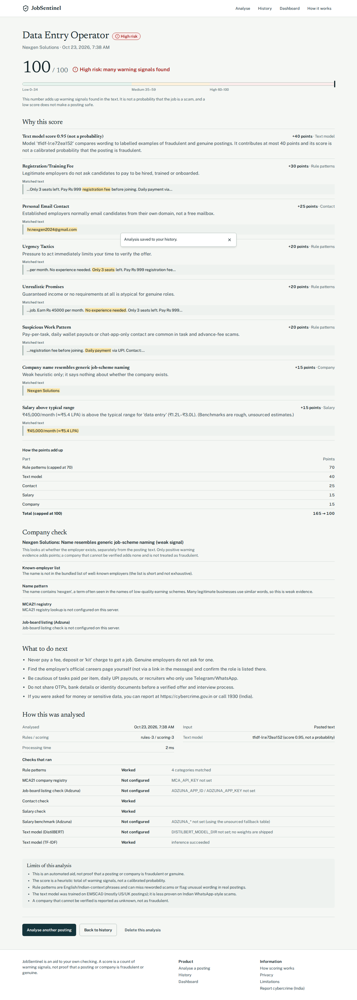

# JobSentinel

A web app that checks a job posting (pasted text, a public web link, or a PDF/.txt file) for scam warning signs and shows the exact
words, contact details and numbers behind each flag. It is an aid to your own verification, **not proof** that a posting or company is
fraudulent or genuine.



| | |
|---|---|
| **Backend** | FastAPI · SQLAlchemy 2 · Alembic · PostgreSQL · scikit-learn |
| **Frontend** | React 19 · Vite · Tailwind CSS v4 · React Router |
| **Quality gates** | 192 backend tests (real PostgreSQL) · 30 frontend tests · 3 real-browser E2E tests · ruff · mypy · ESLint (+jsx-a11y) · migration drift check |

More screenshots (real, captured by the E2E suite): [`docs/screenshots/`](docs/screenshots).

## What it does

- Analyses pasted text, a public URL (SSRF-guarded), or an uploaded PDF/.txt.
- Returns a 0–100 **heuristic warning-signal total**, a level (low / medium / high), every signal with its matched text highlighted,
  a points breakdown, company-check results (known-employer list and optional job-board listing), recommendations, versions, and which checks ran or failed.
- Saves history per browser (search, filter, sort, pagination), a dashboard computed from stored rows, and per-analysis deletion.

## Architecture

```
Browser (React SPA)  ── X-Session-Token (anonymous, per browser) ──►  FastAPI
                                                                        │ middleware: request-id, timing, body limit, CORS, security headers, rate limit
   extraction (PDF in a killable child process) / url_fetcher (SSRF guard) ──► text
   pipeline ─┬ rules.py     regex signals (6 groups) with exact evidence spans
             ├ contact.py   free-mail, big-name + free-mail impersonation
             ├ salary.py    salary check; real Adzuna percentiles (salary_benchmark.py), unsourced table as fallback
             ├ company.py   known employers · name heuristic · disabled online company search
             ├ listings.py  Adzuna listing cross-check (information only)
             ├ ml.py        DistilBERT (optional) → TF-IDF + logistic regression
             └ scoring.py   additive, capped, versioned
   repository.py ──► PostgreSQL: analyses · analysis_signals · company_checks · rate_limit_buckets
```

## Scoring (`scoring-4`, `rules-15`)

A heuristic total of warning signals, **not a calibrated probability**. Only warning evidence adds points; nothing subtracts, so a low
score means "few signals found", never "safe". Unknown or unverifiable companies add nothing.

`score = min(100, rules + ml + contact + salary + company)`

| Part | Points |
|---|---|
| Rule groups (each counts once, total capped at 70) | fees 30 · MLM 30 · urgency 20 · fee + skipped-interview/assessment selection/offer corroboration 20 · unrealistic promises 20 · work/payment pattern 20 (including direct pay-by-UPI wording) · sensitive data requested by chat/messaging during interview-skipping hiring 30 (45 for any OTP/UPI PIN request) · too-good-to-be-true 10 |
| Text model | `round(clip((score − 0.2) / 0.7, 0, 1) × 40)`: 0 at ≤0.2, full 40 at ≥0.9 |
| Contact | free-mail address 25 once; a known-employer match raises the same warning severity without adding points; explicit Gmail-contact instruction without an address 10 |
| Salary | 30 / 15 / 8 for far above / above / far below the 10th–90th percentile range. Range = Adzuna advertised salaries for the job title (≥30 listings, cached 24 h; only the title is sent) or, if unavailable, a rough unsourced table; the result states which |
| Company | 35 registry says struck off · 15 weak name heuristic |

Levels: ≥60 high, ≥35 medium, otherwise low. Job-board listing results are shown but never scored (scammers copy real listings).

## Model evaluation (real data, held-out)

Data: **EMSCAD** (public Employment Scam Aegean Dataset). The checked-in evaluation input has 15,929 rows after deduplication; see `backend/ml/data/README.md`.
Protocol (`python -m ml.train`, `python -m ml.evaluate`): deduplicate → stratified 60/20/20 split → choose `C` on validation →
refit on train+validation → report on the held-out test split. The evaluation report records whether its input SHA-256 matches the model metadata.

| Held-out test result | Value |
|---|---|
| Stored model artifact, full pipeline at level ≥ medium | 98.4 % precision / 91.4 % recall (127 TP, 2 FP, 12 FN on 3,186 rows) |
| Stored model artifact, full pipeline at high (≥60) | 100 % precision / 2.9 % recall (4 flagged) |
| Fresh isolated retrain on the checked-in CSV, text model ROC-AUC / PR-AUC | 0.986 / 0.918 |
| Fresh isolated retrain, text model at score ≥ 0.5: precision / recall | 0.890 / 0.813 |
| Fresh isolated retrain, full pipeline at level ≥ medium | 94.4 % precision / 73.4 % recall (102 TP, 6 FP, 37 FN) |
| Fresh isolated retrain, full pipeline at high (≥60) | 100 % precision / 3.6 % recall (5 flagged) |

What these numbers do **not** say:
- EMSCAD is mostly US/UK English postings (~4 % fraud). Indian WhatsApp/UPI-style scams are under-represented, and **no labelled Indian dataset was available**, so performance on them is unmeasured.
- The stored model metadata names a different dataset SHA-256 and row count than the evaluation input. Its 98.4 % / 91.4 % result is therefore not verified as independent of training data. A fresh temporary retrain on the evaluation CSV has lower held-out full-pipeline results; the stored model artifacts were not replaced.
- On this EMSCAD test split the rules add little over the fresh model (model-only at medium: precision 0.962, recall 0.734; rules-only: recall 0.022). The new sensitive-data/chat rule does not fire on these Western postings, so it does not change these metrics. Indian patterns remain unvalidated against a representative Indian dataset.
- "High" is rare on EMSCAD because those postings seldom carry fees, free-mail contacts or salary figures.
- Real-world precision depends on how many scams are among postings users submit, which is not 4 %.
- The 100-row file from the original repo is synthetic; the model scoring 100 % on it (`synthetic_india_smoke`) is a smoke test only.

## Local setup

Prerequisites: Python 3.12, Node 22, PostgreSQL 16 (or SQLite for a quick try).

```bash
# Backend
cd backend
python -m venv .venv && source .venv/bin/activate
pip install -r requirements-dev.lock          # exact tested versions (requirements*.txt hold the loose ranges)
cp .env.example .env                          # set DATABASE_URL (postgresql+psycopg://… or sqlite:///./dev.db)
alembic upgrade head
uvicorn app.main:create_app --factory --reload --port 8000     # docs: http://localhost:8000/docs

# Frontend (second terminal)
cd frontend && npm install && npm run dev                      # http://localhost:5173 (proxies /api)
```

Retrain / re-evaluate: `python -m ml.train --data /path/to/fake_job_postings.csv` then `python -m ml.evaluate --data …`.
Purge retained input text: `python -m app.cli purge`.

## Configuration

All backend settings are documented in `backend/.env.example` (a test keeps it in sync with the code). Key ones: `DATABASE_URL`, `CORS_ORIGINS`
(no wildcard allowed in production), `INPUT_TEXT_RETENTION_DAYS` (0 = never store submitted text), `RATE_LIMIT_BACKEND` (`memory` or shared `database`),
`TRUSTED_PROXY_COUNT`, `GEMINI_API_KEY` (optional, web-grounded informational search only), `ADZUNA_APP_ID/KEY` (listing check + real salary benchmarks; `ADZUNA_SALARY_BENCHMARKS=false` keeps the table), `DISTILBERT_MODEL_DIR`. Frontend: `VITE_API_BASE_URL` (production only).

## API (`/api/v1`, OpenAPI at `/docs`)

| Method | Path | Notes |
|---|---|---|
| GET | `/health` | DB status, detection-path status, versions |
| POST | `/analyses` | `job_text` **or** `job_url`; optional `company_name`, `job_title` → 201 |
| POST | `/analyses/upload` | multipart PDF/.txt ≤ 5 MB, ≤ 30 pages |
| GET | `/analyses` | `page`, `page_size ≤ 50`, `risk_level`, `status`, `q`, `sort` |
| GET / DELETE | `/analyses/{id}` | 404 for other browsers' records |
| GET | `/dashboard/summary` | totals and distribution from stored rows |

Everything except `/health` needs `X-Session-Token`. Errors are `{"error": {"code", "message", "request_id", …}}`.

## Testing

```bash
cd backend  && pytest -q                       # SQLite
TEST_POSTGRES_URL=postgresql+psycopg://… pytest -q   # + Alembic migrations, real model, concurrency, on PostgreSQL
ruff check . && mypy app && alembic check      # lint, types, migration drift
cd frontend && npm run lint && npm test && npm run build
bash e2e/run.sh                                # real Chromium → built app → real API → real DB → real model
```

Verified in this build: 192 backend tests on PostgreSQL 16 (188 pass on SQLite alone; 4 need Postgres), 30 frontend tests, 3 browser E2E tests, ruff/mypy/ESLint clean,
migrations 0001→0003 up/down/up on PostgreSQL and SQLite with no drift, `npm audit` 0 vulnerabilities. `pip-audit` has not been run.

## Security and privacy

Implemented and tested: anonymous ownership scoping on every query (other browsers get 404); SSRF guard (scheme/port allow-list, all-addresses-public DNS check, IP pinning,
re-validated redirects, size/type/time caps, bounded concurrency); PDF parsing in a killable child process with CPU/memory limits; body-size limit; explicit CORS;
rate limiting (shared database backend available, atomic under concurrency); parameterised queries with escaped LIKE; generic error bodies with request ids;
CSP/HSTS/frame/nosniff headers on API and a strict CSP for the frontend; no job text and **no API keys in logs** (an httpx logging leak was found and fixed, with regression tests);
model files refused unless their SHA-256 matches; untrusted text rendered as text.

Privacy: submitted text is **not stored by default**; hash, length, results and short excerpts are. Deletion endpoint and retention purge provided.
If Adzuna is configured, the company name and job title are sent to Adzuna.

Remaining risks: the session token is not authentication (whoever holds it sees that history; clearing browser storage loses it); a token in localStorage is exposed by any XSS (mitigated by CSP and escaping);
SSRF guard is unit-tested with mocked transports, not against live sites; pickle loading is only as safe as the artifact directory.

## Deployment (not performed; needs your accounts)

1. Provision PostgreSQL. 2. Backend on Render from `render.yaml` (build `pip install -r requirements.lock`, start runs `alembic upgrade head` then uvicorn; set `CORS_ORIGINS`, optional keys).
3. Frontend on Vercel: root `frontend`, `VITE_API_BASE_URL=https://<render-service>`; `vercel.json` provides SPA rewrites and the CSP — edit its `connect-src` to your API origin if it is not `*.onrender.com`.
4. Check `GET /api/v1/health`. CORS errors → fix `CORS_ORIGINS`; 401 → browser blocking localStorage; `database: unavailable` → `DATABASE_URL`.

## Status

| Area | Status |
|---|---|
| Analysis from text / PDF / .txt, persistence, history, dashboard, delete, ownership isolation, rate limiting, headers, CI config | Implemented and verified |
| TF-IDF model, evaluation on real held-out data | Implemented and verified (on EMSCAD; see caveats) |
| URL fetching + SSRF guard | Implemented; verified with mocked transports and the browser/API stack, **not against live sites** |
| Adzuna listing and Adzuna salary-benchmark lookups | Optional integrations; **not verified against live APIs** (no keys here; India salary coverage unknown) |
| DistilBERT path | Implemented, **unverified** (no weights exist) |
| Deployment to Render/Vercel | Config written; **not deployed** |
| Indian-scam model validation | **Not possible yet**: needs a labelled Indian dataset |
| WHOIS domain age, OCR for scanned PDFs, user accounts | Not implemented |

## Known limitations

English/Indian-context rules; salary falls back to an unsourced table without Adzuna data; known-employer list short; pages needing JavaScript or login can't be fetched; the frontend has no screenshot-diff tests;
free-tier hosts may cold-start; lockfiles target Python 3.12.
